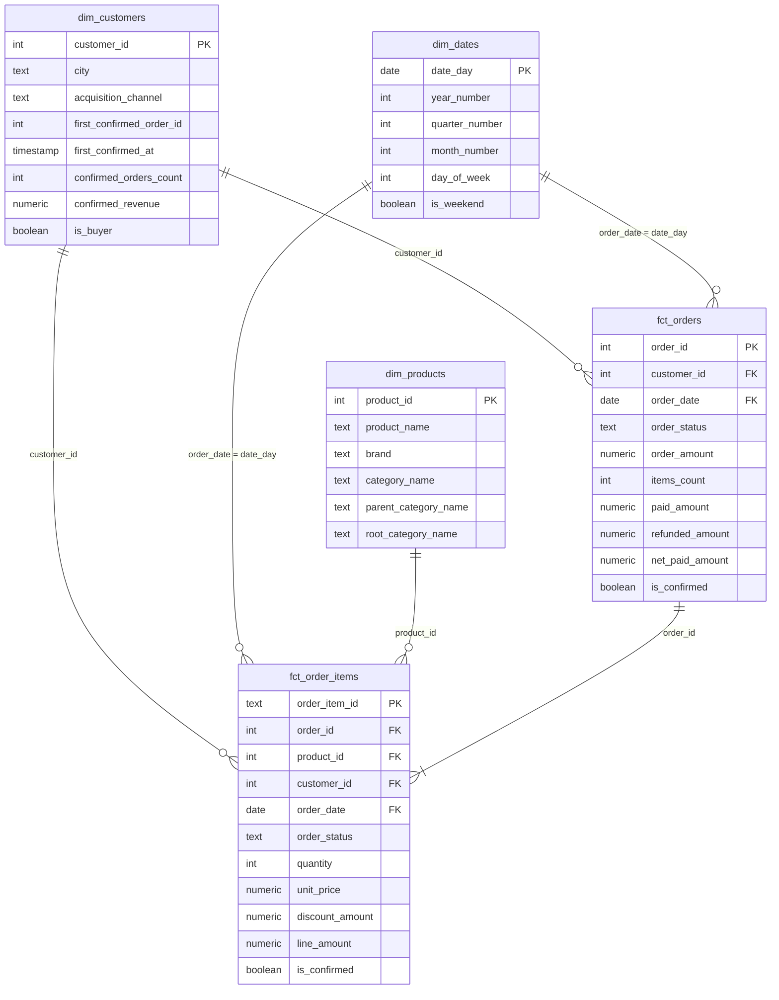

# store_hse: витрины интернет-магазина в Greenplum

Аналитический слой интернет-магазина на dbt. Сырые таблицы OLTP-базы загружаются в Greenplum
(база `dwh`, схема `raw`), а dbt строит из них витрины по схеме «звезда» в схеме `analytics_marts`.

## Запуск

```bash
docker compose down -v && docker compose up -d   # чистые базы и загрузка raw
docker compose logs loader                       # дождаться строки «Готово»
docker compose run --rm dbt build                # ожидается ERROR=0 и один объяснённый WARN
```

Документация проекта:

```bash
docker compose run --rm dbt docs generate
docker compose run --rm --service-ports dbt docs serve --host 0.0.0.0 --port 8080 --no-browser
```

## Модель данных



| Витрина | Зернистость | На какой вопрос отвечает |
| --- | --- | --- |
| `fct_orders` | один заказ | Сколько заработали, какой средний чек по городам, что с оплатами и возвратами |
| `fct_order_items` | один товар в заказе | Какая выручка по месяцам и категориям, какие бренды чаще возвращают |
| `dim_customers` | один клиент, включая не купивших | Какая доля покупателей по каналам привлечения, сколько клиентов не купили ничего |
| `dim_products` | один товар | Как разложить продажи по брендам и категориям любого уровня |
| `dim_dates` | один день | Как сгруппировать продажи по месяцам, кварталам, будням и выходным |

### Граф зависимостей


## Хранение в Greenplum

| Витрина | Распределение | Хранение | Почему |
| --- | --- | --- | --- |
| `fct_orders` | `order_id` | строчное (heap) | Основной ключ соединения, значения уникальны и ложатся по сегментам равномерно. Так же распределены `raw.orders`, `raw.order_items`, `raw.payments` и `fct_order_items` |
| `fct_order_items` | `order_id` | колоночное (append-optimized) | Тот же ключ, что у `fct_orders`, поэтому JOIN идёт локально. Отчёты читают несколько столбцов и агрегируют всю таблицу, колоночному хранению это выгодно |
| `dim_customers` | `replicated` | строчное (heap) | Маленькое измерение: копия на каждом сегменте, факты соединяются с ним без пересылки строк. Когда клиентов станут миллионы, лучше перейти на `distributed by (customer_id)` |
| `dim_products` | `replicated` | строчное (heap) | Маленький справочник, факты распределены не по `product_id`, а JOIN с копией не требует пересылки |
| `dim_dates` | `replicated` | строчное (heap) | Несколько сотен строк, меняется редко, нужен почти в каждом отчёте |

Почему ключи фактов совпадают: строки с одним `order_id` лежат на одном сегменте, и каждый сегмент
соединяет `fct_orders` и `fct_order_items` сам. Если распределить `fct_order_items` по `product_id`,
строки одного заказа разъедутся по сегментам и при каждом JOIN их придётся пересылать по сети
(Redistribute Motion). К тому же товаров всего 13, а продажи между ними неравномерны, поэтому
появится перекос: на одних сегментах данных будет намного больше, чем на других.

`order_status` как ключ тоже не подходит: у него всего 4 значения, а один `paid` занимает большую часть таблицы.

Проверка:

```sql
select c.relname, pg_get_table_distributedby(c.oid) as distribution, am.amname as storage
from pg_class c
join pg_namespace n on n.oid = c.relnamespace
left join pg_am am on am.oid = c.relam
where n.nspname = 'analytics_marts' and c.relkind = 'r';
```

## Инкрементальная модель fct_order_items

Модель собирается с `materialized='incremental'` и `unique_key='order_item_id'`.
Первый запуск строит таблицу целиком. Следующие берут из источника только позиции заказов
за последние 3 дня относительно самой свежей даты в витрине: dbt удаляет эти строки по ключу
и вставляет новые версии. Запас в 3 дня нужен, потому что свежий заказ ещё могут оплатить или отменить.

Что такая модель пропустит:

- **Изменение старого заказа.** Заказ старше 3 дней вернули или оплатили с опозданием: `order_status`
  и `is_confirmed` в витрине останутся прежними. Это самый опасный случай, потому что `fct_orders`
  собирается целиком и покажет новое значение, а две витрины разойдутся.
- **Правку старой позиции.** Изменились количество, цена или скидка: сумма в витрине останется старой.
- **Удаление в источнике.** Удалённая строка в выборку не попадает, поэтому из витрины не удалится.
- **Заказ, задним числом ставший тестовым.** Он останется в витрине, потому что условие `where` его просто не выберет.
- **Заказ, загруженный с опозданием.** Если его дата старше окна в 3 дня, он не попадёт в витрину совсем.

Как с этим жить: тест `assert_order_items_confirmation_is_fresh` замечает расхождение признака
подтверждения с `fct_orders`, а `dbt run --full-refresh -s fct_order_items` пересобирает таблицу целиком.
Такую пересборку разумно запускать по расписанию, например раз в неделю.

Почему не `dbt_utils`: `dbt_packages/` не хранится в репозитории, а `docker compose run --rm dbt build`
сам не выполняет `dbt deps`, поэтому сборка с чистого клона упала бы.

## Тесты

- **Generic:** `unique` и `not_null` на ключи, `relationships` от фактов к измерениям, `accepted_values`
  на статусы и свой `non_negative` из `tests/generic/`.
- **Singular:**

| Тест | Что проверяет |
| --- | --- |
| `assert_order_amount_matches_items` | Сумма заказа равна сумме его позиций |
| `assert_confirmed_revenue_matches_source` | Подтверждённые покупки в витрине совпадают с расчётом по сырым таблицам |
| `assert_returned_orders_fully_refunded` | По возвращённому заказу `net_paid_amount = 0` |
| `assert_confirmed_orders_not_overcharged` | С подтверждённого заказа не списали больше его суммы (WARN) |
| `assert_first_purchase_after_registration` | Первая покупка не раньше регистрации |
| `assert_first_purchase_is_earliest` | `first_confirmed_order_id` указывает на самую раннюю покупку клиента |
| `assert_order_items_confirmation_is_fresh` | `is_confirmed` в позициях совпадает с заказом |
| `assert_refunds_only_for_returned_orders` | Возврат есть только у заказа со статусом `returned` |

### Найденная проблема: двойное списание

Тест `assert_confirmed_orders_not_overcharged` даёт WARN на заказ 113: сумма заказа 200, но прошло
два успешных платежа по 200 с разницей в минуту, списано 400. Излишек в 200 клиенту не возвращён.

Данные мы не исправляем: хранилище должно показывать то, что произошло в источнике, а чинить это
надо там, где родилась ошибка, в платёжном сервисе. Выручка от этого не завышена: она считается по
`order_amount`, а не по платежам, поэтому заказ 113 входит в неё на 200, как и должен.
Тест оставлен с `severity: warn`: сборка не падает, а проблема остаётся на виду.
