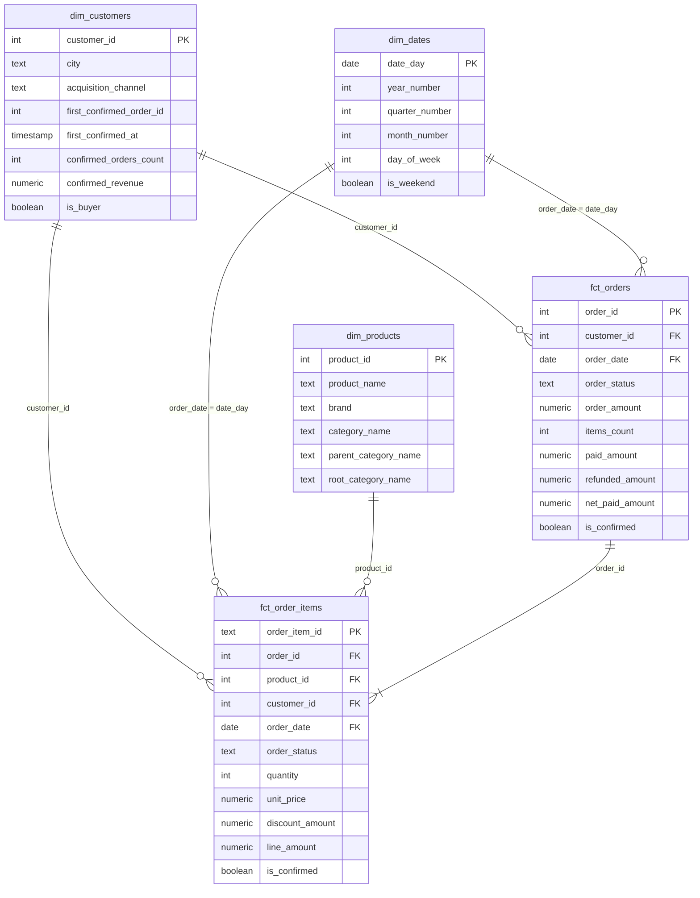
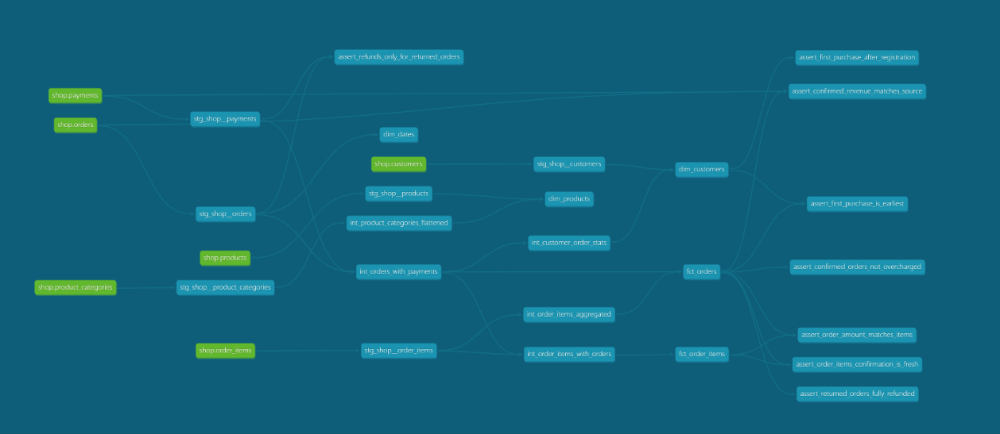

# store_hse

Домашнее задание 1: витрины интернет-магазина в Greenplum.

Loader копирует таблицы магазина в схему `raw`, а dbt собирает из них витрины
по схеме «звезда» в схеме `analytics_marts`.

## Запуск

```bash
docker compose down -v && docker compose up -d   # чистые базы и загрузка raw
docker compose logs loader                       # дождаться строки «Готово»
docker compose run --rm dbt build                # должно быть ERROR=0 и один WARN (заказ 113)
```

Документация проекта:

```bash
docker compose run --rm dbt docs generate
docker compose run --rm --service-ports dbt docs serve --host 0.0.0.0 --port 8080 --no-browser
```

## Модель данных



| Витрина | Зернистость | На какой вопрос отвечает |
| --- | --- | --- |
| `fct_orders` | один заказ | Выручка, средний чек, оплаты и возвраты |
| `fct_order_items` | один товар в заказе | Выручка по категориям, возвраты по брендам |
| `dim_customers` | один клиент, включая не купивших | Покупатели по каналам привлечения и городам |
| `dim_products` | один товар | Бренды и категории товаров |
| `dim_dates` | один день | Отчёты по месяцам, кварталам, выходным |

### Граф зависимостей



## Хранение в Greenplum

| Витрина | Распределение | Хранение | Почему |
| --- | --- | --- | --- |
| `fct_orders` | `order_id` | heap | Значения уникальные, строки ложатся ровно. Так же распределены сырые заказы, позиции и платежи |
| `fct_order_items` | `order_id` | колоночное | JOIN с `fct_orders` идёт локально. Отчёты обычно читают только несколько колонок |
| `dim_customers` | `replicated` | heap | Таблица маленькая, JOIN идёт без пересылки. Если клиентов станет очень много, лучше `distributed by (customer_id)` |
| `dim_products` | `replicated` | heap | Маленький справочник, JOIN идёт без пересылки |
| `dim_dates` | `replicated` | heap | Мало строк, нужен почти в каждом отчёте |

Оба факта распределены по `order_id`, поэтому строки одного заказа лежат на одном сегменте и JOIN
идёт без пересылки. Если распределить `fct_order_items` по `product_id`, для JOIN строки придётся
пересылать по сети (Redistribute Motion). Плюс товаров всего 13 и продаются они неравномерно,
так что будет перекос.

`order_status` тоже плохой ключ: у него 4 значения, и большинство заказов имеют статус `paid`.

Проверка:

```sql
select c.relname, pg_get_table_distributedby(c.oid) as distribution, am.amname as storage
from pg_class c
join pg_namespace n on n.oid = c.relnamespace
left join pg_am am on am.oid = c.relam
where n.nspname = 'analytics_marts' and c.relkind = 'r';
```

### Замеры

Сделал копию `fct_order_items` с `distributed by (product_id)` и сравнил.

Строк на сегментах (0, 1, 2, 3):

| Таблица | Сегмент 0 | Сегмент 1 | Сегмент 2 | Сегмент 3 |
| --- | --- | --- | --- | --- |
| `fct_orders`, `order_id` | 30 | 32 | 34 | 39 |
| `fct_order_items`, `order_id` | 87 | 113 | 98 | 127 |
| Копия, `product_id` | 86 | 76 | 185 | 78 |

При `product_id` на одном сегменте оказалось 185 строк, это перекос.

В `EXPLAIN` для JOIN с `fct_orders` при `order_id` под `Hash Join` нет Motion, соединение идёт на месте.
При `product_id` перед соединением появляется `Redistribute Motion` по `order_id`.
Оценка стоимости почти не отличается (862.05 и 862.06), потому что данных мало.
Опытную таблицу после этого удалил.

## Инкрементальная модель fct_order_items

Из двух вариантов дополнительного задания я выбрал инкрементальную модель (`unique_key='order_item_id'`).
`dbt_utils` не подошёл: проверочная команда не запускает `dbt deps`, а `dbt_packages/` не лежит в репозитории.

Первый запуск строит таблицу целиком. Дальше dbt заменяет только заказы за последние 3 дня от самой
свежей даты в витрине: свежий заказ ещё могут оплатить или отменить.

Что модель пропустит:

- заказ старше 3 дней вернули или оплатили: в витрине останутся старые `order_status` и `is_confirmed`,
  а `fct_orders` покажет новые значения;
- изменили старую позицию: останутся старые количество, цена или скидка;
- строку удалили в источнике: в витрине она останется;
- старый заказ задним числом стал тестовым: из витрины он не исчезнет;
- заказ загрузили с опозданием, и его дата вне окна: в витрину он не попадёт.

Расхождение `is_confirmed` с `fct_orders` ловит тест `assert_order_items_confirmation_is_fresh`.
Исправляется полной пересборкой: `dbt run --full-refresh -s fct_order_items`.

### Проверил на практике

Поменял в `raw.orders` статус старого заказа 101 с `paid` на `returned` и запустил
`dbt run -s fct_orders fct_order_items`.

- `fct_orders` собралась целиком - `SELECT 135`, новый статус виден.
- `fct_order_items` заменила только 9 последних строк - `INSERT 0 9`, заказ 101 не затронут.
- Тест `assert_order_items_confirmation_is_fresh` упал - `FAIL 1`, позиция заказа устарела.

После `dbt run --full-refresh -s fct_order_items` тест снова прошёл.
Потом вернул данные через `docker compose run --rm loader` и пересобрал проект.

## Результат проверки

`dbt build` на чистых базах: `PASS=126 WARN=1 ERROR=0 SKIP=0 TOTAL=127`.
Единственный WARN - заказ 113 с двойным списанием.

Цифры из самопроверки, посчитанные запросами к витринам:

| Проверка | Ожидается | Получилось |
| --- | --- | --- |
| Строк в `fct_orders` | 135 | 135 |
| Подтверждённые заказы | 106 | 106 |
| Сумма подтверждённых заказов | 91 620,00 | 91 620,00 |
| Строк в `fct_order_items` | 425 | 425 |
| Сумма `line_amount` по подтверждённым | 91 620,00 | 91 620,00 |
| `dim_customers`: всего / покупателей | 40 / 29 | 40 / 29 |
| Клиент 1: первый заказ / покупок / сумма | 101 / 9 / 7 280,00 | 101 / 9 / 7 280,00 |
| Клиент 40: покупатель | нет | нет |
| Строк в `dim_products` | 13 | 13 |
| Выручка Electronics | 59 994,28 | 59 994,28 |
| Выручка Home | 31 625,72 | 31 625,72 |
| `dim_dates`: дней и диапазон | 133, 2026-03-01 - 2026-07-11 | 133, 2026-03-01 - 2026-07-11 |

## Тесты

Generic-тесты: `unique`, `not_null`, `relationships`, `accepted_values` и свой `non_negative` из `tests/generic/`.

Singular-тесты:

| Тест | Что проверяет |
| --- | --- |
| `assert_order_amount_matches_items` | Сумма заказа равна сумме его позиций |
| `assert_confirmed_revenue_matches_source` | Подтверждённые покупки в витрине совпадают с расчётом по сырым таблицам |
| `assert_returned_orders_fully_refunded` | По возвращённому заказу `net_paid_amount = 0` |
| `assert_confirmed_orders_not_overcharged` | С подтверждённого заказа не списали больше его суммы (WARN) |
| `assert_first_purchase_after_registration` | Первая покупка не раньше регистрации |
| `assert_first_purchase_is_earliest` | `first_confirmed_order_id` указывает на самую раннюю покупку клиента |
| `assert_order_items_confirmation_is_fresh` | `is_confirmed` в позициях совпадает с заказом |
| `assert_refunds_only_for_returned_orders` | Возврат есть только у заказа со статусом `returned` |

### Что нашёл тест на переплату

`assert_confirmed_orders_not_overcharged` даёт WARN на заказ 113: сумма 200, но прошло два успешных
платежа по 200 с разницей в минуту, то есть списали 400. Возврата лишних 200 в данных нет.

Данные я не менял: ошибка в источнике, и исправлять её надо там. На выручку это не влияет, потому что
она считается по `order_amount`. Поэтому тест стоит с `severity: warn`.
